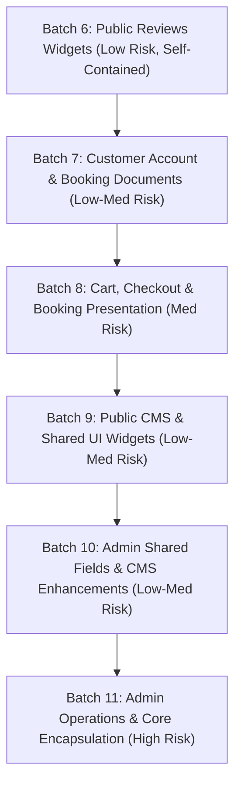

# TravNeeds Components Reorganization Master Plan

**Date**: November 3, 2026  
**Baseline Git Commit**: `dc2c111` (`refactor(components): reorganize components into modular domain directories (batches 1-5)`)  
**Status**: In Progress  

---

## 1. Executive Summary

This Master Plan establishes the definitive domain-driven architectural roadmap to organize all remaining flat components across `components/` and `components/admin/` into high-cohesion, low-coupling directories without altering any application behaviour, styling, or contracts.

### Batches 1–5 Retrospective (Completed & Pushed in Commit `dc2c111`)
- **Cars Domain**: `components/cars/` & `components/admin/cars/` (5 files)
- **SEO Domain**: `components/admin/seo/` (4 files)
- **Tours Domain**: `components/tours/` (4 files)
- **CMS Domain**: `components/admin/cms/` (7 files)
- **Destinations & Blogs**: `components/admin/destinations/` & `components/admin/blogs/` (4 files)
- **Verification**: 268/268 tests passing, 289 routes generating, 0 TypeScript errors.

---

## 2. Complete Remaining Component Inventory & Classification

### A. Root `components/` Directory (41 Files Remaining directly in root)

| Current File | Domain | Responsibility | Importing Files | Target Location | Risk |
| :--- | :--- | :--- | :--- | :--- | :--- |
| **`review-marquee.tsx`** | Reviews | Horizontal animated review marquee | `provider-reviews.tsx`, `website-reviews.tsx` | `components/reviews/` | Low |
| **`website-reviews.tsx`** | Reviews | Curated site review section | `provider-reviews.tsx` | `components/reviews/` | Low |
| **`provider-reviews.tsx`** | Reviews | Consolidated provider reviews | `homepage.tsx` | `components/reviews/` | Low |
| **`reviews.tsx`** & **`reviews-phase6.css`** | Reviews | Tour review drawer & reviews list | `day-tour-detail.tsx`, `tour-detail.tsx` | `components/reviews/` | Low |
| **`account-portal.tsx`** | Account | Core customer dashboard & guest portal | 16 app routes (`/account/**`, `/booking/[token]`) | `components/account/` | Med |
| **`account-custom-trip.tsx`** | Account | Customer custom trip request list | `account-portal.tsx` | `components/account/` | Low |
| **`account-event-requests.tsx`** | Account | Customer event requests list | `account-portal.tsx` | `components/account/` | Low |
| **`authenticated-user.tsx`** | Account | React Context for logged-in user | `account/layout.tsx`, `account-portal.tsx` | `components/account/` | Low |
| **`impersonation-banner.tsx`** | Account | Staff user impersonation notice | `extended-pages.tsx` | `components/account/` | Low |
| **`booking-payment.tsx`** | Booking | Offline bank / Card payment panel | `account-portal.tsx`, `checkout-page.tsx`, `booking-print-document.tsx` | `components/booking/` | Med |
| **`booking-print-document.tsx`** | Booking | Print preview for vouchers & invoices | `account-portal.tsx` | `components/booking/` | Low |
| **`cart-page.tsx`** | Booking | Shopping cart view & checkout CTA | `/cart/page.tsx` | `components/booking/` | Low |
| **`checkout-page.tsx`** | Booking | Checkout stepper & payment selection | `/checkout/page.tsx` | `components/booking/` | Med |
| **`mobile-booking-shortcut.tsx`** | Booking | Sticky mobile bottom booking bar | `day-tour-detail.tsx`, `tour-detail.tsx` | `components/booking/` | Low |
| **`trips-page.tsx`** | Tours | Public catalog & filtering | `/trips/page.tsx` | `components/tours/` | Med |
| **`brand-context.tsx`** | Layout | Dynamic white-label branding | `site.tsx` | `components/layout/` | Med |
| **`brand-favicon.tsx`** | Layout | Dynamic favicon tags | `layout.tsx` | `components/layout/` | Low |
| **`brand-icons.tsx`** | Layout | Brand logo SVG icons | `site.tsx`, `brand-mark.tsx` | `components/layout/` | Low |
| **`brand-mark.tsx`** | Layout | Brand identity header mark | `site.tsx` | `components/layout/` | Low |
| **`header-search.tsx`** | Layout | Header autocomplete instant search | `site.tsx` | `components/layout/` | Med |
| **`navigation-context.tsx`** | Layout | Navigation state & drawer toggle | `site.tsx` | `components/layout/` | Low |
| **`navigation-menu.tsx`** & **`.css`** | Layout | Public primary header navigation | `site.tsx` | `components/layout/` | Med |
| **`notification-panel.tsx`** & **`.module.css`** | Layout | Marketing notification drawer | `site.tsx` | `components/layout/` | Low |
| **`site.tsx`** | Layout | Master public shell (Header/Footer) | 20+ pages | `components/layout/` | High (Retain or late) |
| **`homepage.tsx`** | CMS | Home page composition | `/page.tsx` | `components/cms/` | Med |
| **`homepage-hero.tsx`** | CMS | Interactive hero banner with search | `homepage.tsx` | `components/cms/` | Med |
| **`homepage-hero-preview.tsx`** | CMS | Live hero preview renderer | `homepage-hero.tsx` | `components/cms/` | Low |
| **`cms-additional-pages.tsx`** | CMS | Dynamic CMS page dispatcher | `extended-pages.tsx` | `components/cms/` | Med |
| **`cms-icons.tsx`** | CMS | SVG iconography for CMS sections | `page-visual-editor.tsx`, `extended-pages.tsx` | `components/cms/` (Completed in Batch 12) | Low |
| **`cms-image.tsx`** | CMS | Adaptive image renderer | CMS pages | `components/cms/` (Completed in Batch 12) | Low |
| **`cms-public-link.tsx`** | CMS | Smart CMS internal/external link | CMS pages | `components/cms/` (Completed in Batch 12) | Low |
| **`empty-fleet-hero.tsx`** | CMS | Empty state fallback hero | `extended-pages.tsx` | `components/cms/` | Low |
| **`faq-hero-context.tsx`** | CMS | FAQ hero configuration context | `extended-pages.tsx` | `components/cms/` | Low |
| **`information-page.tsx`** & **`.css`** | CMS | Standard legal/informational layout | `extended-pages.tsx` | `components/cms/` (Completed in Batch 13) | Low |
| **`offer-campaigns.tsx`** & **`campaigns.css`** | CMS | Special offer campaigns grid | `extended-pages.tsx` | `components/cms/` | Low |
| **`page-sections-context.tsx`** & **`.css`** | CMS | Page sections dynamic renderer | `extended-pages.tsx` | `components/cms/` | Low |
| **`presentation-content-context.tsx`** | CMS | Presentation translations | `extended-pages.tsx` | `components/cms/` | Low |
| **`promo-bar-icons.tsx`** | CMS | Top banner promo icons | `site.tsx` | `components/cms/` | Low |
| **`promotion-card.tsx`** | CMS | Promotional visual card | `homepage.tsx` | `components/cms/` (Completed in Batch 12) | Low |
| **`public-appearance.tsx`** | CMS | Custom theme injection | `site.tsx` | `components/cms/` | Low |
| **`server-showcase-hero.tsx`** | CMS | SSR showcase hero banner | CMS routes | `components/cms/` | Low |
| **`server-template-preview.tsx`** | CMS | SSR CMS template preview | CMS preview routes | `components/cms/` | Low |
| **`showcase-hero-context.tsx`** | CMS | Showcase hero context | CMS routes | `components/cms/` | Low |
| **`showcase-hero-preview.tsx`** | CMS | Client showcase preview | CMS preview | `components/cms/` | Low |
| **`extended-pages.tsx`** | CMS | Static content page aggregator | Route wrappers | `components/` (Root) | High |
| **`about-page.tsx`** | CMS | About Us presentation page | `/about/page.tsx` | `components/cms/` (Completed in Batch 13) | Low |
| **`ask-question.tsx`** | Shared | Ask a Question modal & trigger | `day-tour-detail.tsx`, `tour-detail.tsx` | `components/shared/` (Completed in Batch 10) | Low |
| **`country-flag.tsx`** | Shared | Country flag SVG component | Country select | `components/ui/` (Completed in Batch 11A) | Low |
| **`country-select.tsx`** | Shared | Country dropdown with dialing codes | Auth & booking forms | `components/shared/` (Completed in Batch 11A) | Low |
| **`date-input.tsx`** | Shared | Accessible date input | Tour detail, car forms | `components/shared/` (Completed in Batch 11B) | Low |
| **`enquiry-history-tracking.tsx`** | Shared | Visitor enquiry tracker | Forms | `components/shared/` | Low |
| **`event-request-form.tsx`** | Shared | Event request modal form | Event pages | `components/shared/` | Low |
| **`gallery-lightbox.tsx`** & **`.css`** | Shared | Fullscreen image lightbox | Image galleries | `components/shared/` (Completed in Batch 10) | Low |
| **`horizontal-slider.tsx`** | Shared | Accessible horizontal scroll slider | Tour & video carousels | `components/shared/` (Completed in Batch 10) | Low |
| **`international-phone-input.tsx`** | Shared | Phone input with validation | Auth, checkout | `components/shared/` (Completed in Batch 11A) | Low |
| **`language-selector.tsx`** | Shared | Locale selector dropdown | Header | `components/shared/` | Low |
| **`live-chat.tsx`** | Shared | Live chat widget trigger | Shell | `components/shared/` (Completed in Batch 10) | Low |
| **`locale.tsx`** | Shared | Locale context & formatters | Everywhere | `components/shared/` (or root) | High |
| **`public-search-page.tsx`** | Shared | Global search results page | `/search/page.tsx` | `components/shared/` | Low |
| **`rich-text-renderer.tsx`** | Shared | Sanitized rich text viewer | Content pages | `components/shared/` (Completed in Batch 13) | Low |
| **`shared-help-cta.tsx`** & **`.css`** | Shared | Bottom CTA banner | Extended pages | `components/shared/` | Low |
| **`shared-select.tsx`** | Shared | Base UI custom select | Forms | `components/shared/` (Completed in Batch 11C) | Low |
| **`social-icons.tsx`** | Shared | Social media SVGs | Footer | `components/shared/` | Low |
| **`staff-preview-bootstrap.tsx`** | Shared | Preview mode bootstrap | Admin preview | `components/shared/` | Low |
| **`sustainability-badge.tsx`** | Shared | Sustainability pledge pill | Footer | `components/shared/` | Low |
| **`whatsapp-chat.tsx`** | Shared | Floating WhatsApp button | Shell | `components/shared/` (Completed in Batch 10) | Low |
| **`auth-pages.tsx`** | Auth | Login & registration views | `/login`, `/register` | `components/auth/` (Completed in Batch 9) | Med |

---

### B. Root `components/admin/` Directory (32 Files Remaining)

| Current File | Domain | Responsibility | Importing Files | Target Location | Risk |
| :--- | :--- | :--- | :--- | :--- | :--- |
| **`admin-shell.tsx`** | Core | Master admin navigation & layout | All admin pages | `components/admin/core/` | High (Retain) |
| **`admin-ui.tsx`** | Core | Admin UI cards, tables, stats | All admin pages | `components/admin/core/` | High (Retain) |
| **`admin-confirm-dialog.tsx`** | Core | Delete & confirm modal dialog | Admin views | `components/admin/core/` | Med |
| **`admin-pagination.tsx`** | Core | Table pagination controls | Admin tables | `components/admin/core/` | Med |
| **`admin-table-sort.tsx`** | Core | Table column sorting hook | Admin tables | `components/admin/core/` | Med |
| **`admin-toaster.tsx`** | Core | Admin toast notification system | Admin views | `components/admin/core/` | Med |
| **`admin-locale.tsx`** | Core | Admin locale switcher | Admin pages | `components/admin/core/` | Med |
| **`admin-currency.tsx`** | Core | Admin currency switcher | Admin pages | `components/admin/core/` | Med |
| **`admin-back.tsx`** | Core | Header back button | Admin pages | `components/admin/core/` | Low |
| **`module-ui.tsx`** | Core | Add-ons catalogue cards | Add-ons page | `components/admin/core/` | Low |
| **`content-language-tabs.tsx`** | Shared UI | Language tabs for content | Editors | `components/admin/ui/` | Med |
| **`image-field.tsx`** | Shared UI | Image upload & preview field | All builders | `components/admin/ui/` | Med |
| **`rich-text-editor.tsx`** | Shared UI | Tiptap 3 rich text editor | All builders | `components/admin/ui/` | Med |
| **`creation-timeline.tsx`** & **`.css`** | Shared UI | Step timeline progress indicator | New builders | `components/admin/ui/` | Low |
| **`gallery-form.tsx`** & **`gallery-text.tsx`**| Shared UI | Media gallery inputs | Builders | `components/admin/ui/` | Low |
| **`tour-cta-picker.tsx`** | Shared UI | Link tour CTA selector | Editorial | `components/admin/ui/` | Low |
| **`cms-reference-picker.tsx`** | Shared UI | Entity link picker | Page visual editor | `components/admin/ui/` | Low |
| **`trip-builder.tsx`** | Tours | Trip wizard builder | `/admin/trips/builder` | `components/admin/tours/` | High (Retain) |
| **`trip-builder-preview.tsx`** & **`.css`** | Tours | Trip live preview modal | Trip builder | `components/admin/tours/` | High (Retain) |
| **`campaign-fields.tsx`** | CMS | Special offer campaign fields | Offers builder | `components/admin/cms/` | Low |
| **`promo-bar-fields.tsx`** | CMS | Top announcement bar fields | Appearance | `components/admin/cms/` | Low |
| **`website-appearance.tsx`** & **`.css`** | CMS | Theme and brand customizer | Appearance | `components/admin/cms/` | Low |
| **`editorial-sections-editor.tsx`** | CMS | Editorial sections repeater | Hero editor | `components/admin/cms/` | Low |
| **`cms-nav.css`** | CMS | CMS sub-navigation tabs style | CMS layout | `components/admin/cms/` | Low |
| **`notifications-page.tsx`** | Operations | Notifications center dashboard | `/admin/notifications` | `components/admin/operations/` | Low |
| **`revenue-trend.tsx`** | Operations | Monthly revenue chart widget | Admin dashboard | `components/admin/operations/` | Low |
| **`review-integrations.tsx`** | Operations | Google/TripAdvisor reviews sync | Reviews admin | `components/admin/operations/` | Low |
| **`website-enquiries.tsx`** | Operations | Inbound customer enquiry table | `/admin/inbox` | `components/admin/operations/` | Low |

---

## 3. Ordered Migration Batches

### Batches 6–11B Retrospective (Completed in Commit `15ca2c2`)
- **Batch 6**: Public Reviews Widgets (`components/reviews/`)
- **Batch 7**: Customer Account Portal (`components/account/`)
- **Batch 8**: Booking, Cart & Checkout (`components/booking/`)
- **Batch 9**: Public Auth Pages (`components/auth/`)
- **Batch 10**: Shared UI Presentation Widgets (`components/shared/` - `ask-question.tsx`, `gallery-lightbox.tsx`, `horizontal-slider.tsx`, `live-chat.tsx`, `whatsapp-chat.tsx`)
- **Batch 11A**: Shared International Inputs (`components/shared/` - `country-select.tsx`, `international-phone-input.tsx`, `components/ui/country-flag.tsx`)
- **Batch 11B**: Shared Date Input (`components/shared/date-input.tsx`)

### Batch 11C: Shared Custom Select (Completed)
- **Target**: `components/shared/`
- **File**: `components/shared-select.tsx` $\rightarrow$ `components/shared/shared-select.tsx`
- **Consumers**: 49 consuming files updated across admin, forms, and public pages.
- **Verification**: 278/278 tests passed, 291 routes statically generated, 0 TypeScript errors.

### Batch 12: Public CMS Utilities (Completed)
- **Target**: `components/cms/`
- **Files**:
  - `components/cms-icons.tsx` $\rightarrow$ `components/cms/cms-icons.tsx`
  - `components/cms-image.tsx` $\rightarrow$ `components/cms/cms-image.tsx`
  - `components/cms-public-link.tsx` $\rightarrow$ `components/cms/cms-public-link.tsx`
  - `components/promotion-card.tsx` $\rightarrow$ `components/cms/promotion-card.tsx`
- **Consumers**: 6 consuming files updated.
- **Verification**: 278/278 tests passed, 291 routes statically generated, 0 TypeScript errors.

### Batch 13: Public CMS Content Pages & Shared Rich Text (Completed)
- **Target**: `components/cms/` & `components/shared/`
- **Files**:
  - `components/about-page.tsx` $\rightarrow$ `components/cms/about-page.tsx`
  - `components/information-page.tsx` $\rightarrow$ `components/cms/information-page.tsx`
  - `components/information-page.css` $\rightarrow$ `components/cms/information-page.css`
  - `components/rich-text-renderer.tsx` $\rightarrow$ `components/shared/rich-text-renderer.tsx`
- **Consumers**: 8 consuming files updated (`extended-pages.tsx`, `hero-catalogue.ts`, `accessible-travel`, `egypt-travel-guide`, `website-cms-preview`, hotel preview, trip preview, hotel & tour detail pages).
- **Verification**: 278/278 tests passed, 291 routes statically generated, 0 TypeScript errors.

### Recommended Batch 14: Shared Public CTAs & Brand Utilities
- **Target**: `components/shared/`
- **Candidate Files**:
  - `components/shared-help-cta.tsx` & `components/shared-help-cta.css` $\rightarrow$ `components/shared/shared-help-cta.tsx` & `.css`
  - `components/language-selector.tsx` $\rightarrow$ `components/shared/language-selector.tsx`
  - `components/event-request-form.tsx` $\rightarrow$ `components/shared/event-request-form.tsx`
  - `components/enquiry-history-tracking.tsx` $\rightarrow$ `components/shared/enquiry-history-tracking.tsx`
  - `components/social-icons.tsx` $\rightarrow$ `components/shared/social-icons.tsx`
  - `components/sustainability-badge.tsx` $\rightarrow$ `components/shared/sustainability-badge.tsx`
- **Risk Level**: **Low**. Self-contained UI components consumed by shell footer, header, and informational pages.

---

## 4. Execution Rules
1. Never move high-risk orchestrators (`admin-shell.tsx`, `admin-ui.tsx`, `site.tsx`, `trip-builder.tsx`, `locale.tsx`) in early batches.
2. Execute exactly one verified batch at a time.
3. Validate every move with `typecheck`, `test`, and Next.js production build (`npx next build --webpack`).

