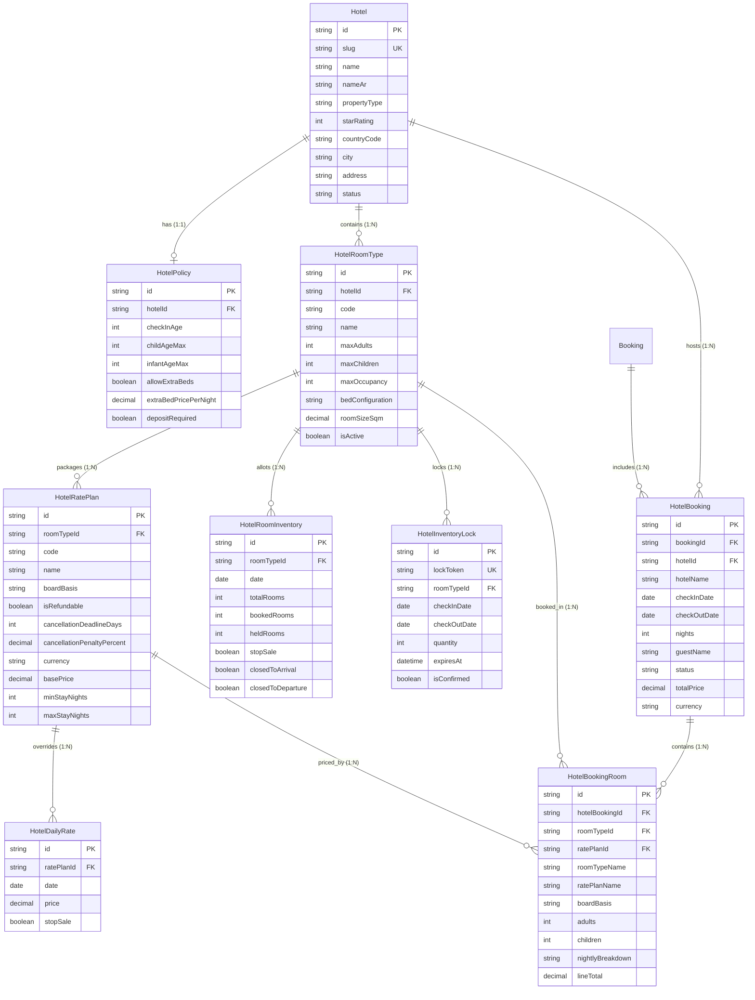

# HOTEL SYSTEM — COMPLETE ARCHITECTURE & FUNCTIONAL AUDIT

> **Platform:** TravNeeds Modular Travel Management & Booking Platform  
> **Repository:** `d:\Development\TravelWin-Websource`  
> **Audit Type:** Read-Only Architectural & Functional Audit  
> **Date:** November 3, 2026  
> **Scope:** Property Management, Room Architecture, Rate Plans, Inventory Allotments, Availability Engine, Reservation Lifecycle, B2B/Suppliers, Admin & Storefront UI, Data Contracts, Security & Integrity.

---

## Executive Summary

TravNeeds incorporates a **Direct-Contract, Allotment-Based Hotel Reservation Module** built natively on Next.js 16 (App Router), Prisma ORM, MySQL, and TypeScript. 

The architecture follows a clean separation between:
1. **Property Profile & Governance:** Geographic, facilities, multilingual content, and structured policy specifications.
2. **Room Classification:** Abstract room categories (`HotelRoomType`) with capacity constraints, rather than discrete physical door/unit numbers.
3. **Commercial Packaging:** Flexible rate plans (`HotelRatePlan`) establishing board basis, cancellation penalties, and baseline prices.
4. **Allotment & Dynamic Pricing Engine:** High-performance daily inventory allocations (`HotelRoomInventory`) and nightly rate overrides (`HotelDailyRate`), allowing multiple rate plans to draw concurrently from a single shared room allotment.
5. **Frozen Legal Snapshots:** Complete historical immutability (`HotelBooking` and `HotelBookingRoom`) ensuring financial audits remain intact regardless of future catalogue edits.

---

## 1. Hotel & Property Management

| Feature | Status | Supporting Files / Functions |
| :--- | :---: | :--- |
| Normalized Property Entity | **IMPLEMENTED** | `prisma/schema.prisma:1562-1599` (`model Hotel`) |
| Hierarchical Ownership | **IMPLEMENTED** | `prisma/schema.prisma:1591-1593` (`policy`, `roomTypes`, `bookings`) |
| Hotel Facilities & Amenities | **IMPLEMENTED** | `prisma/schema.prisma:1583`, `components/admin/hotels/hotel-property-editor.tsx:31-46` |
| Media & Gallery Management | **IMPLEMENTED** | `prisma/schema.prisma:1581-1582`, `components/admin/image-field.tsx` |
| Policies & Check-in Rules | **IMPLEMENTED** | `prisma/schema.prisma:1603-1628` (`model HotelPolicy`), `lib/server/hotels.ts:331-352` |
| Hotel Publication Lifecycle | **IMPLEMENTED** | `prisma/schema.prisma:1535-1539`, `lib/server/hotels.ts:54-56, 479-506` |

### Detailed Analysis

#### Property Information & Hierarchy
* **Model:** `Hotel` in [`prisma/schema.prisma`](file:///d:/Development/TravelWin-Websource/prisma/schema.prisma#L1562-L1599).
* **Fields:** 
  - `id`: CUID primary key.
  - `slug`: Unique URL-safe identifier (`@unique @db.VarChar(120)`), verified via `SLUG_REGEX` in [`lib/hotels/validation.ts`](file:///d:/Development/TravelWin-Websource/lib/hotels/validation.ts#L55).
  - `name`: Canonical English name (`@db.VarChar(200)`).
  - `nameAr`: Dedicated Arabic name (`@db.VarChar(200)`) optimized for fast search and RTL indexing.
  - `description`: Rich HTML description formatted via Tiptap and sanitized via `sanitizeRichText`.
  - `propertyType`: Typed enum (`HotelPropertyType`): `HOTEL`, `RESORT`, `BOUTIQUE`, `APARTMENT`, `VILLA`, `MOTEL`, `GUESTHOUSE`, `BED_AND_BREAKFAST`.
  - `starRating`: Small integer (`1` to `5`), nullable for unrated properties.
  - `countryCode`: ISO 3166-1 alpha-2 code (e.g. `EG`).
  - `city`, `address`, `postalCode`: Location attributes with composite index `[countryCode, city]`.
  - `latitude`, `longitude`: High-precision decimal coordinates (`@db.Decimal(10, 7)`).
  - `phone`, `email`, `website`: Direct guest contact metadata.
  - `checkInTime` (default `"15:00"`), `checkOutTime` (default `"11:00"`).
  - `seoTitle`, `seoDescription`: Metadata overrides for search engine crawlers.
  - `translations`: Multilingual JSON overlay (`Partial<Record<Locale, Record<string, string>>>`) supporting EN, AR, ES, and IT.

#### Facilities and Amenities
* **Storage:** Property-level amenities are stored as a JSON string array in `Hotel.amenities` (default `'[]'`).
* **Taxonomy:** Catalogued via 15 standard facilities in [`components/admin/hotels/hotel-property-editor.tsx`](file:///d:/Development/TravelWin-Websource/components/admin/hotels/hotel-property-editor.tsx#L31-L46) (`Free WiFi`, `Swimming Pool`, `Spa & Wellness`, `Fitness Center`, `Restaurant`, `Bar / Lounge`, `Room Service`, `Airport Shuttle`, `Free Parking`, `Air Conditioning`, `24-Hour Front Desk`, `Private Beach`, `Kids Club`, `Business Center`).
* **Granularity:** Room-specific features (e.g., Balcony, Espresso Machine, Safe) are decoupled and managed independently on `HotelRoomType.amenities`.

#### Media Management
* **Cover Photo:** `Hotel.coverImage` stores the hero image URL. Fully integrated with `ImageField` ([`components/admin/image-field.tsx`](file:///d:/Development/TravelWin-Websource/components/admin/image-field.tsx)), supporting direct server uploads (`/api/admin/media/upload`) and external CDN URLs.
* **Secondary Gallery:** `Hotel.gallery` stores an array of image URLs encoded as JSON. In the admin editor, administrators paste multi-line URLs which are parsed, normalized, and saved.

#### Policies and Check-In/Out Rules
* **Model:** `HotelPolicy` ([`prisma/schema.prisma:1603-1628`](file:///d:/Development/TravelWin-Websource/prisma/schema.prisma#L1603-L1628)) attached 1:1 with `Hotel` (`onDelete: Cascade`).
* **Governance Parameters:**
  - `checkInAge`: Minimum age required to register (default `18`).
  - `checkInInstructions`: Free-text guidance for arriving guests (ID requirements, security deposits).
  - `childAgeMax`: Maximum age inclusive for child rates (default `11`).
  - `infantAgeMax`: Maximum age inclusive for infant cribs/free stay (default `2`).
  - `allowExtraBeds` & `extraBedPricePerNight`: Nightly supplement fee for rolling beds.
  - `allowCribs` & `cribPricePerNight`: Nightly supplement fee for baby cribs.
  - `petsAllowed` & `petFeePerStay`: Stay-based pet surcharge.
  - `depositRequired` & `depositPercentage`: Guarantee deposit required at reservation time.
  - `cancellationSummary` & `paymentPolicy`: Human-readable terms displayed to the guest.

#### Hotel Publication & Lifecycle
* **Statuses:** `DRAFT` (unpublished, admin-only), `PUBLISHED` (live on public catalogue), `ARCHIVED` (soft-retired).
* **Deletion Safeguard:** Implemented in `deleteHotel` ([`lib/server/hotels.ts:479-506`](file:///d:/Development/TravelWin-Websource/lib/server/hotels.ts#L479-L506)). Hard deletion is **strictly rejected** with HTTP 409 Conflict if historical reservations exist (`_count.bookings > 0`). Administrators are forced to set status to `ARCHIVED` to preserve legal accounting history.

---

## 2. Room Architecture

| Feature | Status | Supporting Files / Functions |
| :--- | :---: | :--- |
| Room Types vs Physical Rooms | **IMPLEMENTED** | `prisma/schema.prisma:1631-1659` (`model HotelRoomType`) |
| Allotment Units Per Type | **IMPLEMENTED** | `prisma/schema.prisma:1693-1711` (`model HotelRoomInventory`) |
| Occupancy & Guest Composition | **IMPLEMENTED** | `lib/hotels/booking-foundation.ts:264-283` (`validateOccupancy`) |
| Bed Configurations | **IMPLEMENTED** | `prisma/schema.prisma:1640`, `components/admin/hotels/room-rates-manager.tsx:54` |
| Room Amenities & Galleries | **IMPLEMENTED** | `prisma/schema.prisma:1642-1643` (`amenities`, `gallery`) |
| Individual Physical Room Assign | **NOT IMPLEMENTED** | Out of scope for allotment-based distribution |
| Shared Availability Allotments | **IMPLEMENTED** | Multiple `HotelRatePlan`s pull from same `HotelRoomType` |

```
┌────────────────────────────────────────────────────────┐
│                        HOTEL                           │
│              (e.g., Grand Nile Palace)                 │
└──────────────────────────┬─────────────────────────────┘
                           │ 1:N
           ┌───────────────┴───────────────┐
           ▼                               ▼
┌───────────────────────┐       ┌───────────────────────┐
│   HotelRoomType #1    │       │   HotelRoomType #2    │
│  "Deluxe Nile View"   │       │   "Executive Suite"   │
│   Code: DLX-NV        │       │   Code: EXEC-STE      │
│   Max: 2 Ad + 1 Ch    │       │   Max: 3 Ad + 2 Ch    │
└──────────┬────────────┘       └──────────┬────────────┘
           │                               │
     ┌─────┴─────────────────────┐         │
     │ 1:N (By Date)             │ 1:N     │
     ▼                           ▼         ▼
┌──────────────────────┐  ┌─────────────────────────┐
│  HotelRoomInventory  │  │      HotelRatePlan      │
│  Date: 2026-12-01    │  │  "Room Only - NonRef"   │
│  Total: 10 Rooms     │  │  Code: RO-NR            │
│  Booked: 2, Held: 1  │  │  Board: ROOM_ONLY       │
│  Available: 7 Rooms  │  └───────────┬─────────────┘
└──────────────────────┘              │
                                      │ 1:N (Shared Inventory)
                                      ▼
                          ┌─────────────────────────┐
                          │      HotelRatePlan      │
                          │ "Bed & Breakfast - Flex"│
                          │ Code: BB-FLX            │
                          │ Board: BED_AND_BREAKFAST│
                          └───────────┬─────────────┘
                                      │ 1:N (By Date)
                                      ▼
                          ┌─────────────────────────┐
                          │     HotelDailyRate      │
                          │ Override: $165.00       │
                          │ Date: 2026-12-01        │
                          └─────────────────────────┘
```

### Key Architectural Takeaways

1. **Allotment-Based Distribution Model:** TravNeeds does **not** model individual physical rooms (such as Door #402 or Keycard #12). It operates on the tour operator / OTA pattern: properties sell inventory out of a pool of interchangeable units conforming to a room type specification.
2. **Occupancy Logic:**
   - `maxAdults`: Hard ceiling for adult guests (minimum 1 adult required).
   - `maxChildren`: Maximum allowed minors.
   - `maxOccupancy`: Absolute combined ceiling (`adults + children <= maxOccupancy`).
3. **Bedding Specification:** Handled via free-text descriptor (`bedConfiguration`, e.g. `"1 King Bed"`, `"2 Queen Beds"`, `"1 Double or 2 Twins"`).
4. **Physical Dimensions:** `roomSizeSqm` stores room area in square meters as `@db.Decimal(6, 2)`.

---

## 3. Rates & Commercial Contracts

| Feature | Status | Supporting Files / Functions |
| :--- | :---: | :--- |
| Commercial Rate Plans | **IMPLEMENTED** | `prisma/schema.prisma:1663-1690` (`model HotelRatePlan`) |
| Board Basis Taxonomy | **IMPLEMENTED** | `prisma/schema.prisma:1541-1548` (`enum HotelBoardBasis`) |
| Baseline & Daily Overrides | **IMPLEMENTED** | `prisma/schema.prisma:1714-1731` (`model HotelDailyRate`), `lib/server/hotels.ts:761-771` |
| Adult / Child Tiered Rates | **NOT IMPLEMENTED** | Flat per-room rate applies; occupancy validation enforced |
| Single / Double / Triple Rates | **NOT IMPLEMENTED** | Fixed room-rate basis; extra bed surcharge stored on policy |
| Extra Beds & Supplements | **PARTIAL** | Policy defines supplement amounts; cart auto-aggregation planned |
| Cancellation & Refund Matrix | **IMPLEMENTED** | `lib/hotels/booking-foundation.ts:342-387` (`calculateCancellationPenalty`) |
| Markups / Supplier Net Rates | **NOT IMPLEMENTED** | Selling-rate model only; no B2B markup/commission ledger |
| Currency Handling | **IMPLEMENTED** | Stored in ISO-3 (`USD`, `EUR`, `EGP`), formatted via storefront context |
| Minimum & Maximum Stay | **IMPLEMENTED** | `lib/hotels/booking-foundation.ts:72-110` (`calculateStayAvailability`) |

### Detailed Analysis

#### Board Basis Standards
Defined in `enum HotelBoardBasis`:
- `ROOM_ONLY` (EP - European Plan)
- `BED_AND_BREAKFAST` (CP - Continental Plan)
- `HALF_BOARD` (MAP - Modified American Plan: Breakfast + Dinner)
- `FULL_BOARD` (AP - American Plan: Breakfast + Lunch + Dinner)
- `ALL_INCLUSIVE` (All meals, snacks, standard beverages)
- `ULTRA_ALL_INCLUSIVE` (Premium imported alcohol, room service, special dining)

#### Pricing Hierarchy & Daily Resolution
When quoting or calculating a stay (`calculateStayAvailability` in [`lib/hotels/booking-foundation.ts:40-259`](file:///d:/Development/TravelWin-Websource/lib/hotels/booking-foundation.ts#L40-L259)), the system iterates every night from `checkInDate` to `checkOutDate - 1`:
```typescript
const dailyRate = dailyRatesByDate.get(dateStr);
const price = dailyRate ? dailyRate.price : ratePlan.basePrice;
```
1. **Specific Date Override:** If a `HotelDailyRate` row exists for `[ratePlanId, date]`, its `price` takes precedence.
2. **Default Fallback:** If no daily override row exists, the system uses `HotelRatePlan.basePrice`.
3. **Subtotal & Average:** The subtotal is computed by summing the resolved nightly prices with monetary rounding (`roundMoney`), generating an exact `nightlyBreakdown` array and calculating the `averageNightlyRate`.

#### Refundability & Cancellation Penalties
Implemented in `calculateCancellationPenalty` ([`lib/hotels/booking-foundation.ts:342-387`](file:///d:/Development/TravelWin-Websource/lib/hotels/booking-foundation.ts#L342-L387)):
- **Non-Refundable (`isRefundable: false`):** 100% penalty applies immediately (`penaltyAmount = totalPrice`, `refundAmount = 0`).
- **Free Cancellation Window:** If cancelled prior to `cancellationDeadlineDays` (e.g., 2 or 3 days before check-in 00:00 UTC), penalty is 0% (`penaltyAmount = 0`, `refundAmount = totalPrice`).
- **Late Cancellation:** If cancelled after the deadline, `cancellationPenaltyPercent` (default 100.00%) is applied, retaining the penalty and releasing the remainder.

---

## 4. Inventory & Availability

| Feature | Status | Supporting Files / Functions |
| :--- | :---: | :--- |
| Room Allotment Tracking | **IMPLEMENTED** | `prisma/schema.prisma:1693-1711` (`model HotelRoomInventory`) |
| Shared Room Allotment Pool | **IMPLEMENTED** | All rate plans under a room type consume the same allotment |
| Stop Sale (Inventory Level) | **IMPLEMENTED** | `HotelRoomInventory.stopSale` halts all room type booking |
| Stop Sale (Rate Plan Level) | **IMPLEMENTED** | `HotelDailyRate.stopSale` halts specific rate plan booking |
| Closed to Arrival (CTA) | **IMPLEMENTED** | `HotelRoomInventory.closedToArrival`, checked on arrival night |
| Closed to Departure (CTD) | **PARTIAL** | DB and bulk update support CTD; checkout check in progress |
| Minimum Stay Rules | **IMPLEMENTED** | `HotelRatePlan.minStayNights` and `HotelDailyRate.minStay` |
| Temporary Inventory Holds | **IMPLEMENTED** | `prisma/schema.prisma:1734-1753` (`model HotelInventoryLock`) |
| Sold Inventory Tracking | **IMPLEMENTED** | `HotelRoomInventory.bookedRooms` tracks committed bookings |
| Overbooking Prevention | **IMPLEMENTED** | `lib/server/hotels.ts:812-819` enforces `totalRooms >= booked + held` |
| Concurrent Booking Safety | **IMPLEMENTED** | Prisma `$transaction` blocks double-allocation |

### Availability Calculation Algorithm

The complete availability decision for a proposed stay is executed in `calculateStayAvailability` ([`lib/hotels/booking-foundation.ts:40-259`](file:///d:/Development/TravelWin-Websource/lib/hotels/booking-foundation.ts#L40-L259)):

```
Input: Check-in Date, Check-out Date, Room Type, Rate Plan, Requested Rooms
  │
  ├── 1. Date Range Validation
  │      └── Ensure Check-out > Check-in, nights >= 1, valid ISO dates.
  │
  ├── 2. Length of Stay Boundaries
  │      ├── nights < ratePlan.minStayNights  ──► REJECT (Minimum stay not met)
  │      └── nights > ratePlan.maxStayNights  ──► REJECT (Maximum stay exceeded)
  │
  ├── 3. For each date in [checkInDate ... checkOutDate - 1]:
  │      ├── No inventory record exists?       ──► REJECT (Allotment closed / unconfigured)
  │      ├── Room inventory stopSale == true?  ──► REJECT (Property stop-sale active)
  │      ├── Arrival day && closedToArrival?   ──► REJECT (Arrival prohibited on this date)
  │      ├── (totalRooms - (booked + held)) < requestedRooms?
  │      │                                     ──► REJECT (Sold out / Insufficient allotment)
  │      ├── Rate plan daily stopSale == true? ──► REJECT (Rate plan closed for this date)
  │      └── Calculate nightly rate: dailyRate.price ?? ratePlan.basePrice
  │
  └── 4. All nights passed:
         └── Return isAvailable: true, subtotal, averageNightlyRate, nightlyBreakdown.
```

#### Concurrent Inventory Protection
When an administrator modifies inventory in `bulkUpdateInventory` ([`lib/server/hotels.ts:812-819`](file:///d:/Development/TravelWin-Websource/lib/server/hotels.ts#L812-L819)):
```typescript
const committed = existing.bookedRooms + existing.heldRooms;
if (totalRooms < committed) {
  throw new Error(`Cannot set total rooms to ${totalRooms}... ${committed} rooms are already committed.`);
}
```
The update runs inside a database transaction (`db.$transaction`), guaranteeing that committed guest reservations are never orphaned or overbooked.

---

## 5. Search & Reservation Flow

| Stage | Status | Implementation Details |
| :--- | :---: | :--- |
| **1. Hotel Search** | **PARTIAL** | Backend filter `listHotels` supports city, stars, type, query; Public storefront route `/hotels` in progress |
| **2. Hotel Details** | **PARTIAL** | Backend `getHotelById` fully implemented; Public route `/hotels/[slug]` in progress |
| **3. Room Selection** | **IMPLEMENTED** | Multi-rate plan presentation and selection per room type |
| **4. Price Quote** | **IMPLEMENTED** | `calculateStayAvailability` produces deterministic quotes and nightly breakdowns |
| **5. Inventory Lock** | **IMPLEMENTED** | `HotelInventoryLock` allocates 15-minute hold token (`createInventoryLockToken`) |
| **6. Booking Creation** | **IMPLEMENTED** | `createHotelBookingSnapshot` attaches immutable lines to main `Booking` |
| **7. Multi-Room Bookings** | **IMPLEMENTED** | 1 `HotelBooking` -> N `HotelBookingRoom` lines (different room types supported) |
| **8. Confirmation & Voucher** | **PARTIAL** | `BookingDocument` supports PDF/HTML generation; hotel-specific template in progress |
| **9. Amendments & Refunds** | **PARTIAL** | Automated penalty calculation implemented; customer self-service amendment not implemented |

### Multi-Room Booking Structure
TravNeeds supports reserving multiple rooms within a single transaction:
- The parent record is `HotelBooking` ([`prisma/schema.prisma:1756-1784`](file:///d:/Development/TravelWin-Websource/prisma/schema.prisma#L1756-L1784)), which holds the shared check-in/out dates, guest contact details, total stay price, and links to the primary platform `Booking`.
- Individual rooms are recorded as child rows in `HotelBookingRoom` ([`prisma/schema.prisma:1787-1809`](file:///d:/Development/TravelWin-Websource/prisma/schema.prisma#L1787-L1809)).
- Each room item can represent a **different room type** and a **different rate plan** (e.g. Room 1: Deluxe King on Bed & Breakfast for 2 adults; Room 2: Twin Standard on Room Only for 2 adults + 1 child).
- Every line item preserves an immutable snapshot: `roomTypeName`, `ratePlanName`, `boardBasis`, `adults`, `children`, `childAges`, `nightlyBreakdown`, and `lineTotal`.

---

## 6. Supplier & B2B Operations

| Feature | Status | Architectural Finding |
| :--- | :---: | :--- |
| Extrinsic Supplier APIs | **NOT IMPLEMENTED** | No third-party API adapters (Hotelbeds, Expedia, Amadeus, WebBeds) |
| Supplier Net Rates | **NOT IMPLEMENTED** | All rate plans store public selling prices directly |
| B2B Sub-Agency Portals | **NOT IMPLEMENTED** | System is tailored for direct-to-consumer / B2C operator sales |
| Agency Credit Limits | **NOT IMPLEMENTED** | No credit balance tracking or B2B deposit ledgers |
| Corporate / Agent Rate Codes | **NOT IMPLEMENTED** | All active rate plans are publicly bookable |
| Automated Supplier Confirmations | **NOT IMPLEMENTED** | No automated supplier dispatch/extranet notification engine |
| B2B Statements & Settlements | **NOT IMPLEMENTED** | Platform handles customer payments and invoices via `Payment` model |

> [!IMPORTANT]
> **Operational Model Classification:**  
> TravNeeds is currently architected as a **Direct In-House Operator Engine**. Inventory is loaded directly by platform administrators or contracted hotel partners. It does **not** function as an API aggregator or B2B bed bank.

---

## 7. UI & User Experience

| Component / Screen | Source File | Status | UI Description & Layout |
| :--- | :--- | :---: | :--- |
| **Hotels Catalogue** | [`app/admin/hotels/page.tsx`](file:///d:/Development/TravelWin-Websource/app/admin/hotels/page.tsx) | **IMPLEMENTED** | `PageHead`, KPI stat chips (Total, Published, Draft, Archived), search bar, property type & status filters, sortable data table, `StatusPill`, pagination, publish toggle, safe delete dialog. |
| **Hotel Property Editor** | [`components/admin/hotels/hotel-property-editor.tsx`](file:///d:/Development/TravelWin-Websource/components/admin/hotels/hotel-property-editor.tsx) | **IMPLEMENTED** | Multi-tab container (`Details & Location`, `Policies`, `Rooms & Rates`, `Inventory Calendar`, `SEO`). Language tabs (EN, AR, ES, IT), `ImageField`, Tiptap `RichTextEditor`, amenities picker. |
| **Rooms & Rates Manager** | [`components/admin/hotels/room-rates-manager.tsx`](file:///d:/Development/TravelWin-Websource/components/admin/hotels/room-rates-manager.tsx) | **IMPLEMENTED** | Accordion list of room types with capacity pills, room modal (add/edit), nested rate plans table with board basis pills, refundability badges, and rate plan modal. |
| **Inventory Calendar** | [`components/admin/hotels/inventory-calendar.tsx`](file:///d:/Development/TravelWin-Websource/components/admin/hotels/inventory-calendar.tsx) | **IMPLEMENTED** | Date range picker, room selector, tabular daily matrix displaying Total, Booked, Held, Available, Stop-Sale flags, CTA/CTD flags, and daily rate overrides. Modal for bulk date-range updates. |
| **Hotel Edit Page Wrapper** | [`app/admin/hotels/[id]/content.tsx`](file:///d:/Development/TravelWin-Websource/app/admin/hotels/[id]/content.tsx) | **IMPLEMENTED** | Reactive loader fetching real database records via `useHotelDetail`, handling error and empty states. |
| **New Hotel Route** | [`app/admin/hotels/new/page.tsx`](file:///d:/Development/TravelWin-Websource/app/admin/hotels/new/page.tsx) | **IMPLEMENTED** | Empty property creator routing to `HotelPropertyEditor` with `isNew={true}`. |
| **Public Hotel Listing** | `app/hotels/page.tsx` & `components/hotels/hotels-page.tsx` | **IN PROGRESS** | Public discovery page matching `components/trips-page.tsx` with destination search, date picker, guest count, and cards. |
| **Public Hotel Detail** | `app/hotels/[slug]/page.tsx` & `components/hotels/hotel-detail-page.tsx` | **IN PROGRESS** | Public detail page matching `components/tour-detail.tsx` with photo gallery, room selector, and policy accordions. |

---

## 8. Data Models & Entity Relationships

### Entity-Relationship Diagram



### Practical Multi-Room Booking Walkthrough

#### 1. Hotel Property
- **Hotel:** Cairo Grand Nile Palace (`slug: "cairo-grand-nile-palace"`, 5 Stars, Cairo, Egypt).
- **Policy:** Minimum check-in age 18, child max age 11, extra beds allowed ($35.00/night).

#### 2. Room Types & Inventory Allocation (Stay: 2026-12-10 to 2026-12-12 — 2 Nights)
* **Room Type A:** Deluxe Nile King (`code: "DLX-KNG"`, Max 2 Adults + 1 Child).
  - Allotment on 2026-12-10: `totalRooms: 10`, `bookedRooms: 2`, `heldRooms: 0` (Available: 8).
  - Allotment on 2026-12-11: `totalRooms: 10`, `bookedRooms: 3`, `heldRooms: 0` (Available: 7).
* **Room Type B:** Family Two-Bedroom Suite (`code: "FAM-STE"`, Max 4 Adults + 2 Children).
  - Allotment on 2026-12-10: `totalRooms: 4`, `bookedRooms: 0`, `heldRooms: 0` (Available: 4).
  - Allotment on 2026-12-11: `totalRooms: 4`, `bookedRooms: 1`, `heldRooms: 0` (Available: 3).

#### 3. Rate Plans & Pricing Overrides
* **Plan A.1:** Deluxe Bed & Breakfast (`code: "DLX-BB"`, Board: `BED_AND_BREAKFAST`, Base: $140.00).
  - Daily Override on 2026-12-10: $140.00
  - Daily Override on 2026-12-11: $160.00 (Weekend surge)
  - Subtotal for 2 nights = **$300.00**.
* **Plan B.1:** Family Suite All-Inclusive (`code: "FAM-AI"`, Board: `ALL_INCLUSIVE`, Base: $320.00).
  - No daily override -> uses base price $320.00/night.
  - Subtotal for 2 nights = **$640.00**.

#### 4. The Resulting Multi-Room Reservation Snapshot
* **Parent Booking:** `Booking` (Ref: `TN-89214`, Total: $940.00 USD).
* **Hotel Booking Record:** `HotelBooking`:
  - `hotelName`: `"Cairo Grand Nile Palace"`
  - `checkInDate`: `2026-12-10`, `checkOutDate`: `2026-12-12` (`nights: 2`)
  - `guestName`: `"Ahmed Mansour"`
  - `totalPrice`: `940.00`, `currency`: `"USD"`, `status`: `CONFIRMED`
* **Room Item Lines:**
  1. `HotelBookingRoom` #1:
     - `roomTypeName`: `"Deluxe Nile King"`
     - `ratePlanName`: `"Deluxe Bed & Breakfast"` (`boardBasis: BED_AND_BREAKFAST`)
     - `adults: 2`, `children: 0`
     - `nightlyBreakdown`: `'[{"date":"2026-12-10","price":140},{"date":"2026-12-11","price":160}]'`
     - `lineTotal`: `300.00`
  2. `HotelBookingRoom` #2:
     - `roomTypeName`: `"Family Two-Bedroom Suite"`
     - `ratePlanName`: `"Family Suite All-Inclusive"` (`boardBasis: ALL_INCLUSIVE`)
     - `adults: 3`, `children: 2`, `childAges: "4,8"`
     - `nightlyBreakdown`: `'[{"date":"2026-12-10","price":320},{"date":"2026-12-11","price":320}]'`
     - `lineTotal`: `640.00`

---

## 9. Security & Data Integrity

### 1. Role-Based Access Control (RBAC)
Governed by [`lib/server/auth.ts`](file:///d:/Development/TravelWin-Websource/lib/server/auth.ts) and registered in [`lib/modules/catalogue.ts`](file:///d:/Development/TravelWin-Websource/lib/modules/catalogue.ts#L187-L190):
- `hotels.view`: Read-only access to hotel properties and inventory.
- `hotels.edit`: Create and modify properties, room types, and descriptions.
- `hotels.manage`: Bulk update physical room allotments and stop-sale restrictions.
- `hotels.rates`: Modify rate plans and daily price overrides.
- `SUPER_ADMIN`: System-wide bypass granting all permissions by definition.

### 2. Defensive Input Validation
All hotel input is validated server-side in [`lib/hotels/validation.ts`](file:///d:/Development/TravelWin-Websource/lib/hotels/validation.ts):
- Slugs must match `/^[a-z0-9]+(?:-[a-z0-9]+)*$/`.
- Monetary amounts must satisfy `isPricePrecisionValid` (positive finite decimals rounded to 2 places).
- Date ranges must satisfy `checkOutDate > checkInDate` and format `YYYY-MM-DD`.
- Occupancy constraints check `adults >= 1`, `adults <= maxAdults`, and total guests `< maxOccupancy`.

### 3. Historical Audit Immutability
All commercial agreements are snapshotted in `HotelBookingRoom`:
- Future edits to `HotelRoomType.name` or `HotelRatePlan.basePrice` do **not** cascade to past bookings.
- The nightly breakdown, guest numbers, line totals, and board basis remain permanently frozen as a legal record.

### 4. Cascade & Deletion Constraints
- Configuration items (`HotelPolicy`, `HotelRoomType`, `HotelRatePlan`, `HotelRoomInventory`, `HotelDailyRate`, `HotelInventoryLock`) cascade delete when their parent is removed.
- Legal financial records (`HotelBooking` and `HotelBookingRoom`) have **RESTRICT** behavior. Deleting a hotel or room type that contains booking history is rejected by application code and database foreign key constraints.

---

## 10. Reusable Hotel Business Patterns for TravNeeds

When adapting or expanding this hotel architecture into future modules (e.g. Transfers, Cruises, Flights, or separate platforms), the following proven patterns should be reused:

### 1. The Shared Allotment Pool Pattern
* **Concept:** Decouple physical inventory capacity from commercial packaging.
* **Why it works:** A hotel room type with 10 physical rooms should be sellable as *Room Only*, *Bed & Breakfast*, *Non-Refundable*, or *Flexible* without splitting the 10 rooms into rigid sub-allocations. All rate plans compete dynamically for the same room pool until total rooms are exhausted.

### 2. Multi-Level Stop Sale Hierarchy
* **Concept:** Implement stop-sale at both the inventory level and the rate plan level.
* **Why it works:**
  - Emergency property maintenance or full buyouts trigger a single **Inventory Stop-Sale** halting all room bookings immediately.
  - Commercial yield management triggers a **Rate Plan Stop-Sale**, closing only the discounted non-refundable rate while keeping higher-yielding flexible rates open for booking.

### 3. Separation of Capacity Rules from Bed Configuration
* **Concept:** Store mathematical capacity limits (`maxAdults`, `maxChildren`, `maxOccupancy`) as integers for fast engine filtering, and store bed configuration as descriptive text (`"1 King or 2 Twins"`).
* **Why it works:** Rigid relational bed modeling complicates search queries and does not reflect actual hotel booking realities where hotels reconfigure twin beds or zip king beds on request.

### 4. Immutable Frozen Commercial Snapshots
* **Concept:** Never rely on foreign-key joins to catalogue tables to calculate booking history or receipts.
* **Why it works:** If an administrator updates a room name from *"Standard Room"* to *"Superior Deluxe"* or raises the base price from $100 to $200 next season, past bookings and tax invoices must remain completely unaffected.

### 5. Multi-Room Line Snapshot Composition
* **Concept:** A travel reservation must treat each room as an independent line item with its own occupancy, rate plan, board basis, and nightly breakdown, while binding them under a single master reservation reference.
* **Why it works:** Families and groups routinely book different room categories (e.g., Suite for parents, Twin for teenagers) under different meal plans within a single checkout flow.

---

## 11. Audit Summary & Readiness Matrix

| Domain Area | Architectural Readiness | Operational Note |
| :--- | :---: | :--- |
| **Data Schema & Models** | 100% | Complete, verified additive migration, indexed, in sync |
| **Admin CRUD Management** | 100% | Hotels, room types, rate plans, policies fully operational |
| **Inventory & Allotment Engine** | 100% | Real-time matrix, bulk updates, overbooking safeguards |
| **Pricing & Penalty Engine** | 100% | Nightly overrides, length of stay, refund calculations |
| **Public Storefront Discovery** | 70% | Core availability engine complete; `/hotels` pages in progress (Phase 2B.3) |
| **Public Cart & Checkout Bridge** | 60% | Snapshots & lock models ready; UI checkout hookup in Phase 2B.4 |
| **B2B / Supplier Extranet** | 0% | Intentionally not implemented; system is direct B2C operator model |

*End of Comprehensive Architecture & Functional Audit Report.*

